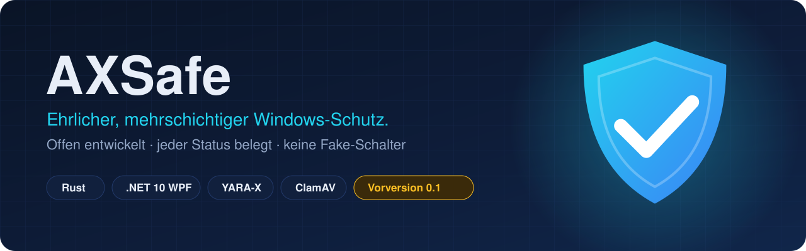
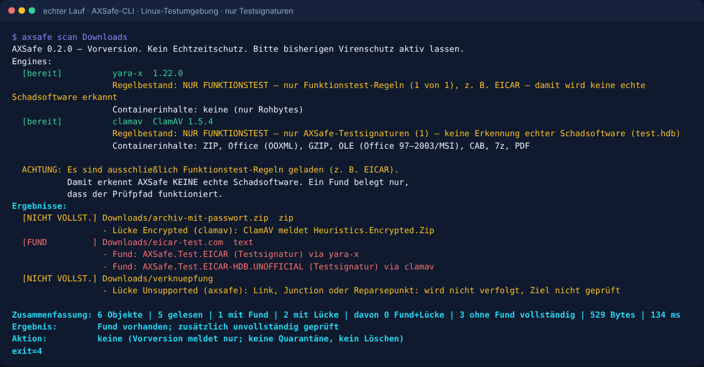
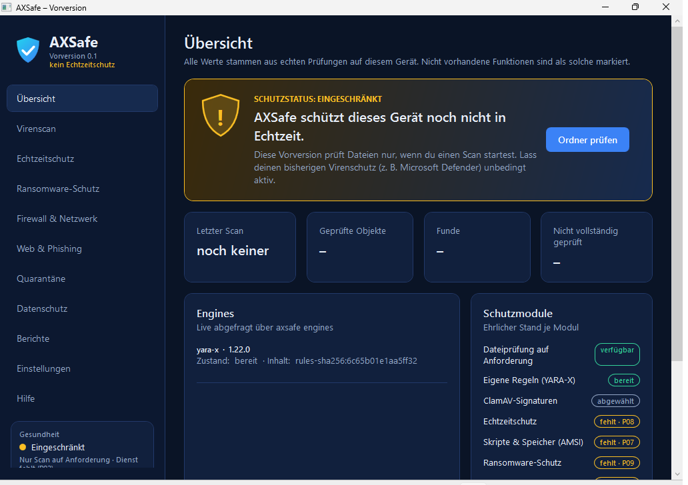
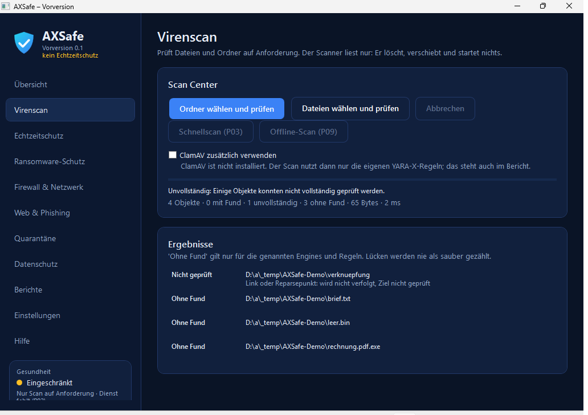
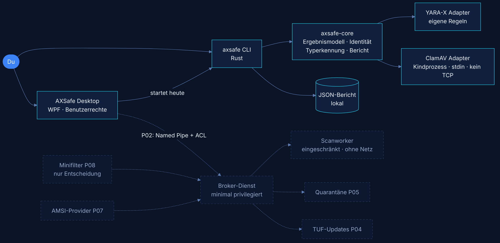
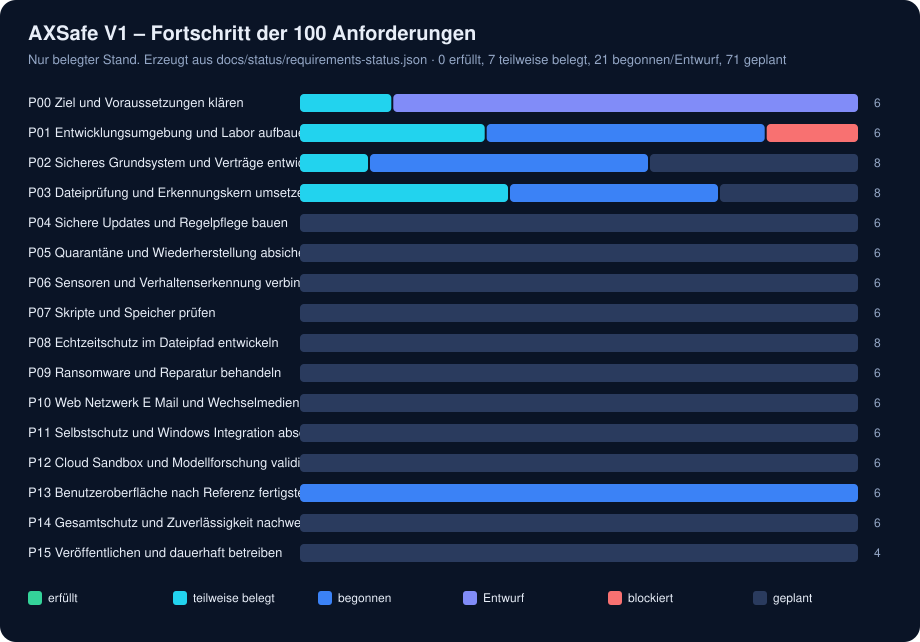

<p align="center">
  
</p>

<p align="center">
  <a href="https://github.com/tkacalex/AXSafe/actions/workflows/ci.yml"></a>
  
  
  
  
  <a href="docs/TEST-MATRIX.md"></a>
</p>

<p align="center">
  <b>Ein Windows-Virenschutz, der dir nie etwas vormacht.</b><br>
  Jeder grüne Haken ist belegt. Jede Lücke wird benannt. Jeder Fortschritt ist öffentlich nachvollziehbar.
</p>

---

> [!WARNING]
> **AXSafe ist eine Vorversion und noch kein Echtzeitschutz.** Es prüft Dateien, wenn *du* einen Scan startest – mehr nicht.
> Lass **Microsoft Defender** (oder deinen bisherigen Schutz) unbedingt aktiv. Kein Antivirus erkennt jede Schadsoftware.

> [!IMPORTANT]
> **Mitgeliefert sind nur Funktionstest-Regeln** (EICAR-Testmuster). Damit erkennt AXSafe **keine echte Schadsoftware** – ein Fund beweist nur, dass der Prüfpfad funktioniert. Echte Signaturen bekommst du über ein installiertes [ClamAV](https://www.clamav.net/downloads) mit `freshclam`. AXSafe zeigt den geladenen Regelbestand immer sichtbar an.

## Inhalt

- [Neu in 0.2](#neu-in-02)
- [Warum AXSafe?](#warum-axsafe)
- [Was AXSafe heute kann – und was nicht](#was-axsafe-heute-kann--und-was-nicht)
- [So sieht es aus](#so-sieht-es-aus)
- [Schnellstart](#schnellstart)
- [Ergebnisse richtig lesen](#ergebnisse-richtig-lesen)
- [Architektur](#architektur)
- [Fahrplan und Fortschritt](#fahrplan-und-fortschritt)
- [Dokumentation](#dokumentation)
- [Mitmachen](#mitmachen) · [Sicherheit](#sicherheit) · [English summary](#english-summary)

## Neu in 0.2

Ein unabhängiger Prüfer hat acht Schwachstellen in Version 0.1 gefunden. **Alle acht sind behoben und mit Tests belegt** – Vorher/Nachher-Reproduktion in [`docs/evidence/`](docs/evidence/), Details im [Änderungsprotokoll](CHANGELOG.md).

| Vorher (0.1) | Jetzt (0.2) |
| --- | --- |
| `--json` auf eine vorhandene Datei überschrieb sie – sogar die geprüfte Datei selbst | Bericht wird **nur neu angelegt**, nie überschrieben; Links, Hardlinks und Junctions werden erkannt |
| Fund + Engine-Fehler wurde nur als „Fund“ gezeigt | **„Fund vorhanden; zusätzliche Prüflücke“** – beides sichtbar |
| ZIP ohne ClamAV galt als „ohne Fund“ | Containerinhalt gilt nur als geprüft, wenn eine Engine ihn **nachweislich** prüft |
| Ein hängender Unterprozess konnte das Zeitlimit aushebeln | **Ein** Ablaufdatum für alles; Unterprozesse werden beendet (Windows: Job Object) |
| Oberfläche konnte einen alten Bericht anzeigen | Jeder Auftrag hat eine **eigene ID**; fremde oder alte Berichte werden abgelehnt |
| Leerer Ordner = „sauber“ | **„Keine prüfbaren Objekte“** |
| Testregeln sahen aus wie echter Schutz | **„NUR FUNKTIONSTEST-REGELN“** unübersehbar in CLI und Oberfläche |
| Fehlendes ClamAV ließ Tests still bestehen | Ausgelassene Tests werden **getrennt gezählt und begründet**; Linux-CI duldet keine Auslassung |

## Warum AXSafe?

Viele Sicherheitsprogramme zeigen große grüne Schilde, egal was im Hintergrund wirklich passiert. AXSafe geht den umgekehrten Weg:

| Grundsatz | Was das konkret heißt |
| --- | --- |
| 🟢 **Grün nur mit Beleg** | Die Oberfläche zeigt nie „Geschützt“, solange kein Echtzeitschutz existiert. Heute steht dort ehrlich *Eingeschränkt*. |
| 🔍 **Lücken sind sichtbar** | Verschlüsselt, zu groß, kein Zugriff, Zeitlimit, Engine-Fehler – all das ist **nie** „sauber“, sondern wird einzeln gemeldet. |
| 🧩 **Mehrere Engines, ein Vertrag** | Eigene Regeln mit [YARA-X](https://github.com/VirusTotal/yara-x), Signaturen mit [ClamAV](https://www.clamav.net/) – austauschbar, einzeln messbar. |
| 🔐 **Sicher gebaut** | Rust-Kern, Typerkennung nach Inhalt, Dateiidentität über das Handle, kein Ausführen, kein Löschen, keine Cloud, keine Telemetrie. |
| 📋 **Öffentlicher Plan** | 16 Phasen, **100 Anforderungen, 100 Abnahmen**. Der Stand jeder einzelnen steht in [`docs/REQUIREMENTS.md`](docs/REQUIREMENTS.md). |

## Was AXSafe heute kann – und was nicht

| ✅ Heute vorhanden (getestet) | ⛔ Noch nicht vorhanden (geplant) |
| --- | --- |
| Dateien und Ordner auf Anforderung prüfen (CLI + Oberfläche) | Echtzeitschutz beim Öffnen/Ausführen (Phase P08) |
| Eigene YARA-X-Regeln mit Pflichtmetadaten und Zeitlimit | Quarantäne und Wiederherstellung (P05) |
| ClamAV als getrennter Prozess **mit Rechtebeschränkung** (Windows: eingeschränktes Token, Integrität Niedrig, kein Zugriff auf private Dateien, Netzwerk per Firewall gesperrt), kein clamd-Port. **Neu:** Die Signaturen bleiben im abgeschotteten `axsafe-clamav-worker` geladen statt für jede Datei neu (B-18); Updates werden erst nach erfolgreichem Laden aktiv | Skript- und Speicherschutz über AMSI (P07) |
| Typerkennung nach Inhalt (EXE/DLL/.NET, Office, PDF, Archive, LNK, ISO …) | Verhaltens- und Ransomware-Schutz (P06, P09) |
| Ehrliche Ergebnisse: Fund und Prüflücke getrennt, JSON-Bericht (Schema v2) | Sichere automatische Updates (P04) |
| Archive nur dann „geprüft“, wenn eine Engine den Inhalt nachweislich prüft; Passwort-ZIP → *verschlüsselt* (mit ClamAV) | Web-, Phishing- und Netzwerkschutz (P10) |
| Engines laufen mit hartem Zeit-, Speicher- und Ausgabelimit | Echte eigene Erkennungsregeln (heute nur Funktionstest) |
| YARA-X und Typerkennung im **abgeschotteten Worker** (Windows: AppContainer ohne Netz und Dateizugriff) – Abschottung wird bei jedem Start nachgewiesen | Prüfung auf Windows 10 LTSC (Labor fehlt noch) |
| **Hintergrunddienst** `AXSafeService` (LocalService, minimale Rechte) mit gesicherter Named Pipe: liest Dateien nur mit **deinen** Rechten, Berichte nur für dich | |
| **Ehrlicher Betriebszustand** (`axsafe zustand`): Scanner, Sensor, Richtlinie, Definitionen, Primärschutz und Dienst einzeln – nie grün ohne Beleg | |
| **Richtlinie mit Ausnahmen** nur durch Administratoren, eng begrenzt und befristet; Ausgenommenes erscheint im Bericht | |
| **Scanarten**: Schnell-, Voll-, Wechseldatenträger- und eigener Scan, Kontextmenü und Zeitplan; Fortschritt, Abbruch und **Fortsetzen** (nur unveränderte Dateien werden übernommen) | |
| **Sicherer Cache im Dienst**: Wiederholte Prüfungen sparen Engine-Zeit nur bei gleichem Inhalt und gleichem Signatur-/Regelstand – nie anhand von Zeitstempeln | |
| **Statische Merkmale**: PE-Struktur, Signatur (Authenticode), Herkunft (Mark of the Web); Heuristik meldet nur Täuschungsmuster wie `Rechnung.pdf.exe` – **mit Belegen**, nie wegen Entropie oder fehlender Signatur allein | |
| Deutsche Oberfläche im dunklen Design, kein Konto nötig | Selbstschutz und Windows-Sicherheitscenter (P11) |

Die vollständige Liste je Dateiformat steht in der [Fähigkeitsmatrix](docs/CAPABILITY-MATRIX.md).

## So sieht es aus

**Kommandozeile – ein echter Lauf** (keine Montage; EICAR ist eine ungefährliche Testdatei):

<p align="center"></p>

Was du hier siehst: AXSafe sagt zuerst ehrlich, **welche Regeln geladen sind** – hier nur Testsignaturen. Die EICAR-Testdatei wird von **beiden** Engines erkannt. Das passwortgeschützte ZIP wird nicht still als „sauber“ gezählt, sondern als **verschlüsselt** gemeldet; das normale ZIP gilt als geprüft, weil ClamAV dessen Inhalt nachweislich untersucht. Die Verknüpfung wird bewusst **nicht** verfolgt. Ergebnis: *Fund vorhanden; zusätzlich unvollständig geprüft* (Exitcode 4) – und *keine Aktion*, die Vorversion meldet nur.

**Oberfläche (WPF, .NET 10):**

<!-- UI-SCREENSHOTS:START -->
<table>
  <tr>
    <td width="50%"></td>
    <td width="50%"></td>
  </tr>
  <tr>
    <td><b>Übersicht</b> – kein grünes Fake-Schild: Status <i>eingeschränkt</i>, und unübersehbar: <i>nur Funktionstest-Regeln geladen</i>. Jede Engine zeigt Bereitschaft, Regelbestand, Containerfähigkeit und Isolation getrennt.</td>
    <td><b>Virenscan</b> – ClamAV fehlt hier und ist sichtbar abgewählt. Die PDF-Datei gilt deshalb als <i>Containerinhalt nicht geprüft</i>, die Verknüpfung wird nicht verfolgt – Ergebnis <i>unvollständig</i>, nicht „sauber“.</td>
  </tr>
</table>
<p align="center"><sub>Automatisch aufgenommen von der CI auf einem Windows-Runner (Windows Server, 1024×768) mit einem Ordner harmloser Testdateien. Die angezeigten Werte werden im selben Lauf per UI Automation gegen das CLI-Ergebnis geprüft.</sub></p>
<!-- UI-SCREENSHOTS:END -->

## Schnellstart

### Variante A – fertiges Windows-Paket (Vorversion)

1. Unter [**Releases**](https://github.com/tkacalex/AXSafe/releases) die neueste Vorversion öffnen und `AXSafe-…-windows-x64-vorversion.zip` laden. Prüfsummen aller Dateien stehen in `SHA256SUMS-….txt`, dazu Stückliste (SBOM), Inventar und Lizenzhinweise.
2. Entpacken, `AXSafe.exe` starten. Die .NET-Laufzeit ist enthalten. Die Kommandozeile liegt in `cli\axsafe.exe`.
3. Optional, aber empfohlen: `scripts\windows\ClamAV-einrichten.cmd` doppelklicken und die Windows-Abfrage (UAC) bestätigen. Das Skript lädt das **offizielle** ClamAV-Paket von Cisco Talos, prüft Prüfsumme und Signatur, richtet die Signaturupdates alle 4 Stunden ein und schreibt einen Nachweisbericht. AXSafe nutzt ClamAV danach automatisch.
4. Optional: `scripts\windows\Dienst-installieren.cmd` (UAC) installiert den Hintergrunddienst. Die Oberfläche zeigt, ob er bereit ist.

Jeder erfolgreiche CI-Lauf stellt außerdem das Artefakt **`axsafe-windows-x64-preview`** bereit ([Actions](https://github.com/tkacalex/AXSafe/actions/workflows/ci.yml?query=branch%3Amain+is%3Asuccess), GitHub-Anmeldung nötig).

> Die Pakete sind noch **nicht signiert**. Windows SmartScreen kann deshalb warnen.

### Variante B – aus dem Quellcode

```bash
git clone https://github.com/tkacalex/AXSafe.git
cd AXSafe
cargo build --release                       # Rust-Version wird automatisch gewählt
./target/release/axsafe scan C:\Users\du\Downloads
dotnet build ui/AXSafe.Desktop -c Release   # Oberfläche (Windows, .NET SDK 10)
```

### Die wichtigsten Befehle

```text
axsafe scan <Pfad>... [--json neuer-bericht.json] [--job-id <UUID>] [--timeout-ms N] [--no-clamav]
axsafe engines [--json]          Zustand und Versionen der Engines
axsafe filetype <Datei>...       Dateityp nach Inhalt (ohne Engine)
AXSafe.exe --scan <Pfad>         Oberfläche öffnen und sofort prüfen
```

Exitcodes für Skripte: `0` vollständig ohne Fund · `1` Fund · `2` unvollständig ohne Fund · `3` Bedienfehler (z. B. Berichtsdatei existiert schon) · `4` Fund **und** unvollständig · `5` keine prüfbaren Objekte.

`--json` legt den Bericht **immer neu an**. Existiert die Datei (oder ein Link, Ordner, Junction) schon, bricht AXSafe vor dem Scan mit Exitcode 3 ab und ändert nichts.

## Ergebnisse richtig lesen

| Ergebnis | Bedeutung |
| --- | --- |
| **Fund** (Schädlich / Verdächtig / PUA) | Fund mit Belegen (Regel, Engine). Bei Testsignaturen steht „(Testsignatur)“ dabei. |
| **Fund vorhanden; zusätzliche Prüflücke** | Es gibt einen Fund **und** eine weitere Engine oder Prüfung konnte nicht vollständig arbeiten. Beides zählt. |
| **Containerinhalt nicht geprüft** | Archiv oder Dokument wurde nur als Rohbytes gelesen; keine aktive Engine prüft dieses Format inhaltlich. |
| **Keine prüfbaren Objekte** | Der Auftrag enthielt nichts Prüfbares (z. B. leerer Ordner). Das ist **kein** „sauber“. |
| **Ohne Fund** | Im angegebenen Umfang, mit den genannten Engines und Regeln nichts erkannt. **Kein Beweis für Harmlosigkeit.** |
| **Verschlüsselt** | Inhalt nicht einsehbar, z. B. Passwort-ZIP. Nicht geprüft. |
| **Nicht geprüft** | Format, Größe oder Objektart (Link, Gerät) nicht unterstützt. |
| **Kein Zugriff** | Fehlende Rechte oder Sperre. Nicht geprüft. |
| **Zeitlimit** / **Fehler** | Engine zu langsam, abgestürzt oder nicht verfügbar. Nicht geprüft. |
| **Geändert** | Datei hat sich während der Prüfung verändert – nicht vollständig geprüft, neu prüfen. Ein Fund bleibt sichtbar. |

Warum so streng? Siehe [ADR-0004: Ehrliches Ergebnismodell](docs/adr/ADR-0004-ergebnismodell.md).

## Architektur

<p align="center"></p>

Durchgezogen = vorhanden, gestrichelt = geplant. Details: [Bedrohungsmodell](docs/THREAT-MODEL.md) · [ADR-0001 Engine-Strategie](docs/adr/ADR-0001-engine-strategie.md) · [ADR-0002 Stack](docs/adr/ADR-0002-technologie-stack.md)

```
crates/axsafe-core           Ergebnismodell, Dateiidentität, Typerkennung, Scan, Bericht
crates/axsafe-engine-yarax   YARA-X-Adapter (eigene Regeln in rules/)
crates/axsafe-engine-clamav  ClamAV-Adapter (clamscan, stdin, ohne TCP)
crates/axsafe-proc           Kindprozesse mit Ablaufdatum, Speicher-/Ausgabegrenze, Job Object, AppContainer, eingeschränktes Token
crates/axsafe-worker         isolierter Scanworker (YARA-X) und Host-Adapter, Abschottungsnachweis
crates/axsafe-service        Windows-Dienst AXSafeService, Named Pipe axsafe.ipc/1
crates/axsafe-cli            Kommandozeile axsafe
ui/AXSafe.Client             Auftrag, Berichtsprüfung, Modell (plattformneutral, getestet)
ui/AXSafe.Desktop            WPF-Oberfläche (.NET 10)
service/ driver/ backend/ research/   Planungsnotizen bzw. geplante Komponenten (Dienstcode: crates/axsafe-service)
docs/                        Plan, Matrizen, ADRs, Blocker, Quellen
```

## Fahrplan und Fortschritt

<p align="center"></p>

<!-- STATUS:START (automatisch erzeugt von scripts/gen_docs.py) -->
| Status | Anzahl |
| --- | ---: |
| ✅ erfüllt | 6 |
| 🟢 teilweise belegt | 14 |
| 🔵 begonnen | 8 |
| 📝 Entwurf | 5 |
| ⛔ blockiert | 1 |
| ⚪ geplant | 66 |
<!-- STATUS:END -->

**Ehrlich gezählt:** „erfüllt“ heißt, die Abnahme ist vollständig mit echten Belegen bestanden. Das ist bisher bei **keiner** der 100 Anforderungen der Fall – auch wenn viele Teile schon funktionieren und getestet sind. Was fehlt und warum, steht im [Blockerregister](docs/BLOCKERS.md).

| Phase | Inhalt | Stand |
| --- | --- | --- |
| P00–P01 | Ziele, Plattform, Labor, Build, CI | 🔵 in Arbeit |
| P02–P03 | Dienst, IPC, Erkennungskern | 🔵 Worker abgeschottet, Dienst und Named Pipe auf Windows Server getestet; LTSC offen |
| P04–P05 | Updates, Quarantäne | ⚪ geplant |
| P06–P10 | Sensorik, AMSI, Echtzeit, Ransomware, Web | ⚪ geplant |
| P11–P15 | Selbstschutz, Cloud, UI, Nachweise, Release | 🔵 UI begonnen, Rest geplant |

## Dokumentation

| Thema | Dokument |
| --- | --- |
| Produktauftrag und V1-Definition | [docs/PRODUKTAUFTRAG.md](docs/PRODUKTAUFTRAG.md) |
| Alle 100 Anforderungen mit Status | [docs/REQUIREMENTS.md](docs/REQUIREMENTS.md) |
| Zielplattform (gemessen) | [docs/PLATFORM.md](docs/PLATFORM.md) |
| Bedrohungsmatrix (33 Klassen) | [docs/THREAT-COVERAGE.md](docs/THREAT-COVERAGE.md) |
| Bedrohungsmodell | [docs/THREAT-MODEL.md](docs/THREAT-MODEL.md) |
| Fähigkeitsmatrix | [docs/CAPABILITY-MATRIX.md](docs/CAPABILITY-MATRIX.md) |
| Testmatrix und Belege | [docs/TEST-MATRIX.md](docs/TEST-MATRIX.md) · [docs/evidence/](docs/evidence/) |
| Blocker und offene Entscheidungen | [docs/BLOCKERS.md](docs/BLOCKERS.md) · [docs/DECISIONS.md](docs/DECISIONS.md) |
| Entscheidungsprotokolle (ADR) | [docs/adr/](docs/adr/) |
| Recht, Lizenzen, Budget | [docs/LEGAL-REVIEW.md](docs/LEGAL-REVIEW.md) · [ADR-0003](docs/adr/ADR-0003-lizenzen.md) · [docs/BUDGET.md](docs/BUDGET.md) |
| Laborregeln | [lab/LAB-RULES.md](lab/LAB-RULES.md) |
| Quellen (60 geprüfte Primärquellen) | [docs/SOURCES.md](docs/SOURCES.md) |
| Ursprüngliche Spezifikation | [docs/spec/](docs/spec/) |

## Mitmachen

Ideen, Fehlerberichte und **Fehlalarm-Meldungen** sind sehr willkommen – nutze die [Issue-Vorlagen](https://github.com/tkacalex/AXSafe/issues/new/choose). Wie entwickelt wird, steht in [CONTRIBUTING.md](CONTRIBUTING.md).

⭐ **Wenn dir der Ansatz „ehrlich statt grün“ gefällt, gib dem Projekt einen Stern** – das hilft, AXSafe sichtbar zu machen.

## Sicherheit

Schwachstellen bitte **privat** melden: [SECURITY.md](SECURITY.md). Das Repository enthält **keine Schadsoftware und keine EICAR-Datei**; Tests erzeugen ungefährliche Testdaten nur zur Laufzeit ([ADR-0005](docs/adr/ADR-0005-testdaten.md)).

## Lizenz

Die Projektlizenz ist **noch nicht festgelegt** ([ADR-0003](docs/adr/ADR-0003-lizenzen.md)). Bis dahin gilt: Code lesen und lernen ja, Weiterverwendung nur nach Rücksprache. Drittkomponenten behalten ihre Lizenzen (YARA-X: BSD-3-Clause, ClamAV: GPL-2.0 – wird nicht mitgeliefert). Jedes Paket enthält `THIRD-PARTY-NOTICES.txt` mit allen Lizenztexten der mitgelieferten Komponenten (erzeugt von `scripts/gen_third_party_notices.py`).

---

## English summary

**AXSafe** is an open-development, multi-layer endpoint protection project for **Windows 10 Enterprise LTSC 2021 / Windows 11 (x64)**, built with a Rust core and a German WPF (.NET 10) desktop UI.

Its core idea is **honesty**: no green shield without evidence, every gap (encrypted, unsupported, access denied, timeout, engine error, changed during scan) is reported explicitly and never counted as "clean". The current **preview 0.2** is an *on-demand scanner* with YARA-X and ClamAV adapters, content-based file type detection, handle-based file identity and machine-readable JSON reports (schema v2: detections and coverage gaps reported side by side). Version 0.2 fixes eight independently reported findings (report overwrite, detection-plus-gap visibility, container coverage, engine timeouts with lingering child processes, report-to-job binding, empty scans, test-only rules, honest test counting). YARA-X and file type detection run in an isolated worker process (Windows: AppContainer without capabilities inside a Job Object; Linux: Landlock), and the isolation is verified at every start by denied write/network/process probes. A Windows service (`AXSafeService`, LocalService, two privileges) accepts scan jobs over a locked-down named pipe, takes the caller's identity from the Windows token and reads files only while impersonating the caller. ClamAV runs with a restricted low-integrity token (an AppContainer was measured to be impossible for ClamAV 1.5) and is installed from the official Cisco Talos package by a verifying setup script. libclamav (GPL-2.0-only) is now loaded once in a separate, equally restricted worker process (`axsafe-clamav-worker`) instead of reloading the signature database for every file; signature updates become active only after a successful load. **The bundled rules are function tests only (EICAR) and detect no real malware. It is not real-time protection – keep Microsoft Defender enabled.** The full plan (16 phases, 100 requirements with acceptance tests) and its live status are in [`docs/REQUIREMENTS.md`](docs/REQUIREMENTS.md).
